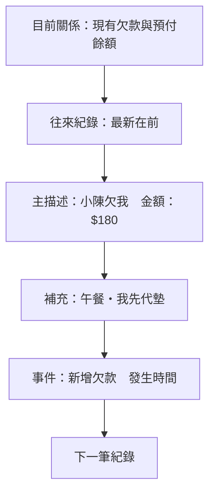
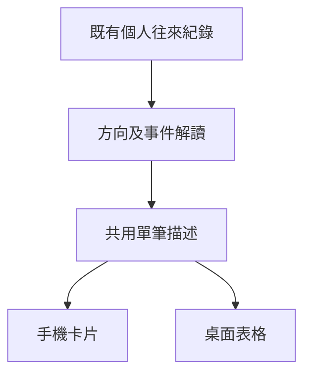

# 往來紀錄的欠款與還款方向辨識 - Plan

## Goal Capsule

- Objective: 使用者查看與某人的往來紀錄時，能從單筆紀錄直接辨識誰欠誰、誰還誰，以及金額。
- Means: 採用方案 B「白話紀錄」，以目前登入者為視角描述每筆帳務事件。
- Product authority: 本次對話中使用者選擇 B，並確認整體範圍；下列 R-ID 為產品行為依據。
- Execution: 自主完成本機實作、驗證、審查與 commit；不推送、不開 PR、不部署。
- Open blockers: 無。

---

## Product Contract

### Summary

將個人往來紀錄改成白話事件描述，讓消費欠款、還款、預付款、返還、沖抵與沖銷都有清楚的雙方角色。
手機與桌面沿用同一套表達方式，保留按時間閱讀的單一紀錄列表。

### Problem Frame

目前雙向消費欠款與還款只顯示相同類型及金額，使用者無法從單筆紀錄知道欠款或付款的雙方角色。

### Key Decisions

- **採用 B「白話紀錄」。** Governs R1–R3, R9, R11。使用者比較 A「方向標籤」、B「白話紀錄」、C「依方向分組」後選擇 B。(session-settled: user-directed — chosen over A direction badges and C directional grouping: explicit sentences make the parties readable while retaining the timeline)
- **一併處理同一份紀錄中的預付款與沖銷。** Governs R4–R8。避免欠款能辨識方向，相關事件卻仍然需要猜測。(session-settled: user-approved — chosen over expense-and-repayment-only coverage: keep related records understandable from the same perspective)
- **區分歷史事件與目前餘額。** Governs R10。使用者已確認保留當次金額與目前欠款的區別。(session-settled: user-approved — chosen over interpreting historical amounts as current debt: later repayments must not make old events misleading)

### Actors

- A1. 目前登入者：紀錄中的「我」。
- A2. 往來對象：以該頁對象的顯示名稱指稱；兩個角色會隨登入者切換。

### Requirements

**事件與方向**

- R1. 所有方向描述以 A1 為「我」、A2 的顯示名稱為對象，不以固定建立者或代墊人作為閱讀視角。
- R2. 消費欠款的主描述依方向顯示「小陳欠我」或「我欠小陳」，並在補充資訊說明誰先代墊。
- R3. 一般還款依方向顯示「小陳還我」或「我還小陳」。
- R4. 預付款依方向顯示「我預付給小陳」或「小陳預付給我」。
- R5. 預付款返還依實際返還方向顯示「我退還小陳的預付款」或「小陳退還我的預付款」。
- R6. 消費使用預付款與預付款自動抵還既有欠款，須分別說明使用誰的預付款及其用途，不描述成另一次現金還款。
- R7. 沖銷還款須指明撤銷誰的還款紀錄及恢復誰的欠款，不描述成退錢或一筆新的付款。
- R8. 原還款已被沖銷時，原紀錄須顯示「已沖銷」，保留原事件內容供辨識。

**閱讀與呈現**

- R9. 每筆以白話主描述與當次金額作為第一閱讀層，交易名稱及連結、備註、發生時間作為補充資訊。
- R10. 紀錄金額表達當次發生的金額；當前剩餘欠款由目前餘額呈現，歷史欠款以「新增欠款」等事件提示避免誤認。
- R11. 往來紀錄維持單一列表，按時間由新到舊排列。
- R12. 手機與桌面呈現相同的角色、事件與狀態語意。
- R13. 文字本身須足以辨識方向，顏色僅作輔助，金額正負號或箭頭不能作為唯一判斷依據。

**既有帳務與例外**

- R14. 此次調整保留既有帳務計算、雙向欠款各自計算的規則、歷史資料、權限與銷帳／沖銷操作條件。
- R15. 語意未明的調整或未識別類型須保留中性類型、金額與既有說明，不推測成新增欠款、還款或資金移轉。

主描述與補充資訊的閱讀順序依 R9；以下為方案 B 的區塊示意，字體及實際配色由實作規劃決定。

### Key Flows

- F1. 辨識雙向事件。登入者開啟某人的往來頁，從每筆主描述與金額辨識事件，必要時閱讀交易與備註，另查看目前餘額。Covers R1–R6, R9–R13。
- F2. 查看已沖銷還款。同一列表中，原還款有已沖銷標示，沖銷事件說明恢復的欠款方向；操作資格依 R14。Covers R7–R8, R11, R14。

### Acceptance Examples

以下名稱、日期與金額皆為模擬資料，不代表實際帳務。

- AE1. **Covers R1–R2, R9, R13.** 我代墊午餐而小陳產生 $180 欠款時，主描述為「小陳欠我 $180」，補充「午餐・我先代墊」；移除顏色仍能辨識方向。
- AE2. **Covers R1–R3, R9, R12.** 小陳代墊咖啡而我產生 $120 欠款時，顯示「我欠小陳 $120」；小陳還我 $80 與我還小陳 $50 分別使用對應還款句子，手機與桌面一致。
- AE3. **Covers R1.** 同一筆欠款由雙方各自登入查看時，債務角色一致，只有「我」與對象名稱隨閱讀者切換。
- AE4. **Covers R4.** 我預付 $300 給小陳與小陳預付 $300 給我，分別顯示「我預付給小陳 $300」與「小陳預付給我 $300」。
- AE5. **Covers R5.** 我返還小陳先前預付的 $100，顯示「我退還小陳的預付款 $100」；反向則顯示「小陳退還我的預付款 $100」。
- AE6. **Covers R6.** 我的預付款用於小陳代墊的 $60 消費時，顯示「以我的預付款支付 $60」，補充由我預付給小陳的餘額扣抵；反向改以小陳的預付款描述。
- AE7. **Covers R3, R6.** 小陳預付的款項先抵還其既有欠款 $80 時，該筆自動沖抵顯示「小陳的預付款抵還欠款 $80」；我的款項抵還時顯示「我的預付款抵還欠款 $80」，與一般還款區分。
- AE8. **Covers R7–R8, R14.** 撤銷小陳還我的 $80 紀錄後，原紀錄顯示「已沖銷」，新紀錄表達「撤銷小陳的還款紀錄 $80」，補充「恢復小陳對我的欠款」；反向則恢復我對小陳的欠款。
- AE9. **Covers R9–R11, R14.** 10:10 我欠小陳 $120、12:30 小陳欠我 $180、13:50 我還 $50、14:10 小陳還 $80 時，列表由 14:10 排到 10:10，歷史欠款仍為 $180 與 $120，目前雙向欠款分別為小陳欠我 $100、我欠小陳 $70。
- AE10. **Covers R9, R15.** 無法確定語意的調整紀錄仍可讀到類型、金額與既有備註，不套用猜測的欠款或付款句子；沒有交易或備註時也能靠主描述辨識已知事件。

### Scope Boundaries

- 本次限於每個人的「往來紀錄」及其必要的呈現資訊；其他頁面的全面改版與新的篩選、分頁、搜尋功能不在範圍。
- 目前關係摘要與既有款項操作沿用 R14；草圖中的兩格摘要只是比較閱讀方式的示意，不取代正式頁面既有的四個指標。
- 外部金流串接、互相抵銷欠款與資料回填不在本次範圍。

### Sources / Research

- `src/app/peers/[peerId]/page-client.tsx`：手機與桌面的往來紀錄呈現，以及目前關係摘要與沖銷入口。
- `src/features/auth/auth.service.ts`：個人往來資料與原還款的已沖銷狀態。
- `src/features/ledger/server/ledger.service.server.ts`：消費、預付沖抵、返還、還款與沖銷的既有事件語意。
- `src/features/ledger/domain/ledger-state.ts`：雙向欠款與預付款的現有計算語意。

---

## Planning Contract

Product Contract unchanged；補入 Problem Frame，產品行為及 R/A/F/AE-ID 保持原義。

### Key Technical Decisions

- KTD1. **以純呈現函式統一解讀雙向事件。** 新增 `src/features/ledger/peer-log-presentation.ts`，由既有紀錄與對象身分產生主描述、事件說明及輔助色分類，手機與桌面共用；不修改 backend response 或帳務演算法。Governs R1–R8, R12–R15。
- KTD2. **保留各裝置既有容器並共用內容。** 手機維持卡片、桌面維持表格；在 `src/app/peers/[peerId]/page-client.tsx` 共用單筆內容元件，金額靠右、名稱可換行，保留既有操作。Governs R9–R14。
- KTD3. **依實際帳務語意辨識自動沖抵。** 預付款抵還欠款沿用現有專用備註識別，消費扣預付與沖銷各自使用獨立敘述；原還款的已沖銷狀態沿用既有資料。Governs R6–R8, R14。
- KTD4. **調整與未識別事件採中性描述。** 目前查得調整只有型別與標籤，沒有可證明增減方向的寫入流程，依 R15 顯示既有類型及備註。

### Impact Inventory

- State transitions / side effects / persistence：無變更，僅解讀已有事件。
- Reports / adjacent surfaces：總覽與交易頁沿用原有類型標籤；本次新描述只用在個人往來紀錄。
- Tests：新增雙向事件解讀與實際手機／桌面內容、沖銷操作條件的測試；既有 ledger-state 測試持續驗證帳務。

### High-Level Technical Design

### Assumptions

- 往來資料已限定為登入者與目前對象；可由對象的 ID 判斷紀錄方向，無須新增登入者 ID 欄位。
- 時間以 `Asia/Taipei` 顯示，採現有金額格式；長名稱與備註允許換行。

---

## Implementation Units

### U1. 統一白話事件解讀

- **Goal:** 各類事件的角色、用途與沖銷效果都能正確表達。
- **Requirements:** R1–R8, R13–R15；AE1–AE8, AE10。
- **Dependencies:** 無。
- **Files:** `src/features/ledger/peer-log-presentation.ts`、`src/features/ledger/peer-log-presentation.test.ts`。
- **Approach:** 依 KTD1, KTD3–KTD4 實作有明確輸入及回傳型別的純呈現函式；名稱與備註維持純文字。
- **Patterns to follow:** `src/features/ledger/type-label.ts` 的既有中性類型標籤、`src/features/ledger/server/ledger.service.server.ts` 的事件語意。
- **Execution note:** 先以雙向輸入與明確預期文字建立失敗測試，再實作。
- **Test scenarios:**
  1. Covers AE1–AE5. 欠款、一般還款、預付與返還在兩個方向都正確，切換閱讀者會交換「我」與名稱。
  2. Covers AE6–AE8. 消費扣預付、自動抵還與撤銷還款不誤寫成其他資金移轉。
  3. Covers AE10. 調整及未知類型保留中性標籤，不推測方向。
- **Verification:** 呈現函式測試通過；不引入資料庫、帳務狀態或金額計算修改。

### U2. 套用白話往來紀錄並驗證操作

- **Goal:** 手機與桌面都能從單筆紀錄直接理解角色、金額與狀態。
- **Requirements:** R1–R15；F1–F2；AE1–AE10。
- **Dependencies:** U1。
- **Files:** `src/app/peers/[peerId]/page-client.tsx`、`src/app/peers/[peerId]/page-client.test.tsx`。
- **Approach:** 依 KTD2 將 U1 結果套入兩種既有容器，補上日期與歷史金額說明；沿用目前紀錄順序、交易連結及按鈕條件。
- **Patterns to follow:** `src/app/events/[eventId]/page-client.test.tsx` 的 Router / actions mock、`src/components/ui/table.tsx`、既有主題色。
- **Test scenarios:**
  1. Covers AE1–AE3, AE9. 同一組雙向欠款與還款在手機與桌面呈現一致，歷史金額與目前餘額分離。
  2. Covers AE8. 已沖銷原還款有狀態標示；僅未沖銷的一般還款有沖銷按鈕，操作仍送出原紀錄 ID。
  3. Covers AE6–AE7, AE10. 自動抵還無沖銷入口，交易連結及自訂備註保留，缺少交易與備註仍有完整主描述。
  4. 在桌面與手機寬度查看真實元件的模擬資料畫面，確認長名稱換行與頁面無水平溢位。
- **Verification:** 元件回歸測試、全測試與 TypeScript 通過；瀏覽器檢查桌面、手機及沖銷互動。

---

## Verification Contract

- `bun run test -- src/features/ledger/peer-log-presentation.test.ts src/app/peers/\[peerId\]/page-client.test.tsx`：驗證事件語意與兩種呈現容器。
- `bun run test`：全套 Vitest，包括既有雙向帳務測試。
- `bunx tsc --noEmit`：型別檢查。
- `bun run build`：正式建置驗證；若依賴本機資料庫或環境，記錄具體限制。
- 以真實 React 元件搭配明確標示的模擬資料進行桌面與手機瀏覽器檢查，不建立實際付款、預付或沖銷資料。
- 完成簡化檢查與程式碼審查，處理有證據的範圍內缺陷。

---

## Definition of Done

- U1–U2 完成，R1–R15 與 AE1–AE10 有適當測試或畫面驗證。
- 既有帳務計算、資料儲存與操作權限依 R14 保留。
- 相關測試、TypeScript 與正式建置通過，或如實列出環境阻礙。
- 移除臨時測試入口、模擬畫面與廢棄嘗試，交付本機 commit，遵守本次 Execution 邊界。
